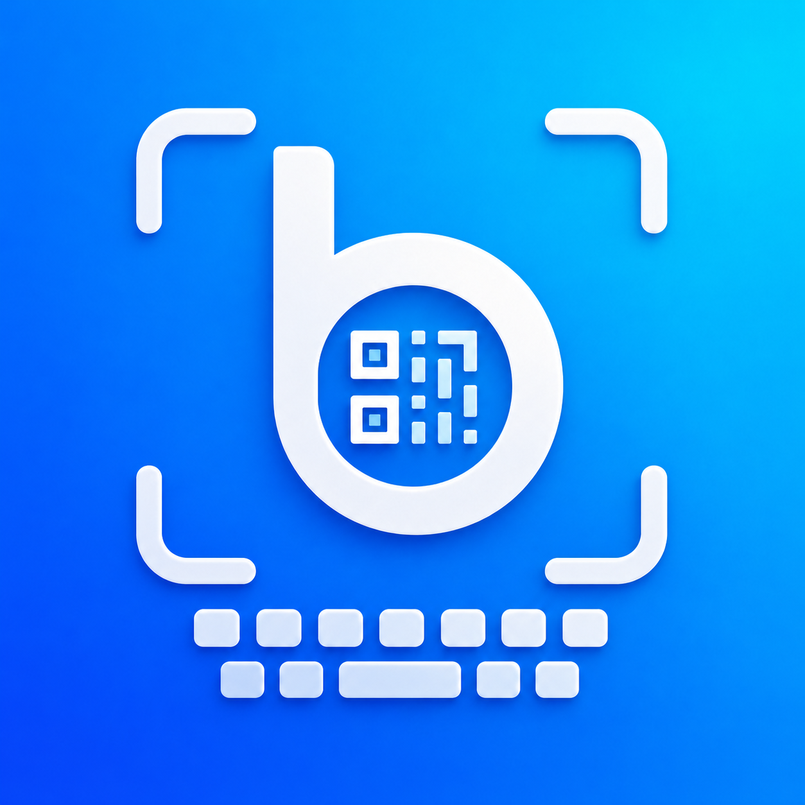

# Blip: Barcode QR Keyboard

Blip is an iOS keyboard scanner for company workflows. It adds a custom keyboard with a scan button, opens an in-app barcode or QR scanner, then inserts the result back into the original text field.



## Features

- Custom iOS keyboard extension with a familiar keyboard-style UI.
- English and German keyboard language options.
- Configurable keyboard profiles: letters, numbers and symbols, big-number pad, or scan-only.
- Scanner built with AVFoundation and Vision.
- Scan-format profiles for common barcodes, barcodes plus QR, or all supported formats.
- Flashlight toggle and default flashlight preference.
- Optional Blip scan sound.
- Automatic return targets: Chrome, Edge, Firefox, Brave, or a custom URL scheme. Safari is a manual fallback.
- App Group handoff so the scanner app can queue a result for the keyboard to insert once.
- Optional automatic insertion; the last scan stays available for an explicit keyboard tap.
- Configurable scan suffix: none, tab, enter, or space.
- Setup flow with keyboard detection, `Check Again`, and a settings shortcut.
- English and German app localization, with an App Language shortcut to iOS Settings.
- System and Blip Blue keyboard themes, with optional key clicks and haptics.
- A native keyboard test field that returns scans to Blip without changing the configured external destination.
- Company profile sharing by file or QR code, with a preview before applying settings.

## How It Works

iOS keyboard extensions cannot access the camera directly, so Blip uses a containing app for scanning:

1. The user taps `Scan` on the custom keyboard.
2. The keyboard opens `blip://scan`.
3. The containing app scans the barcode or QR code.
4. The scan result is saved in the shared App Group with a request id.
5. Blip opens the configured automatic return target. For Safari, the user returns to the original tab manually.
6. If automatic insertion is enabled, the keyboard inserts the matching pending scan through `textDocumentProxy`. Otherwise, the user taps `Insert Last Scan`.

See [Architecture](docs/ARCHITECTURE.md) for more detail and [Company Profiles](docs/COMPANY_PROFILES.md) for the shared configuration format.

## Repository Layout

```text
App/                  Containing SwiftUI app, scanner, setup, and settings
KeyboardExtension/    Custom keyboard extension
Shared/               Shared settings, scan session, and app-group state
Branding/             Product naming and app icon source
docs/                 Architecture, development, and test notes
project.yml           XcodeGen project definition
```

## First-Time Device Setup

1. Build and install the app from Xcode.
2. Open the Blip app.
3. Tap `Open Keyboard Settings`.
4. In iOS Settings, tap `Keyboards`.
5. Enable the Blip keyboard.
6. Enable `Allow Full Access`.
7. Return to Blip and tap `Check Again`.
8. If iOS still does not refresh the keyboard state, fully close and reopen Blip.

For best employee experience, remove unused keyboards from iOS Keyboard settings so users do not accidentally switch to a keyboard without a scanner.

## Development

Open the checked-in project:

```sh
open Blip.xcodeproj
```

Build for simulator:

```sh
xcodebuild -project Blip.xcodeproj \
  -scheme Blip \
  -destination 'generic/platform=iOS Simulator' \
  build
```

Build for a physical iPhone:

```sh
xcodebuild -project Blip.xcodeproj \
  -scheme Blip \
  -destination 'id=<DEVICE_ID>' \
  build
```

More setup notes live in [Development](docs/DEVELOPMENT.md).

Third-party asset credits are tracked in [Third-Party Notices](THIRD_PARTY_NOTICES.md).

## Validation

The important workflow must be tested on a physical iPhone:

- enable keyboard and Allow Full Access
- open the keyboard from a supported automatic return target
- scan from the keyboard
- return to the selected target app
- insert exactly once into the original field
- with automatic insertion off, use `Insert Last Scan`; test Safari's manual return separately

See [Test Plan](docs/TEST_PLAN.md).

## App Store Preparation

Submission copy, screenshot guidance, privacy answers, support/privacy page drafts, and review notes live in [App Store Submission Pack](AppStore/README.md).

## Known Platform Constraints

- Camera access must happen in the containing app, not the keyboard extension.
- iOS does not provide a perfect public "return to previous app" API.
- Return-target behavior needs physical-device testing for each browser or target app.
- Bundle identifier changes should be planned carefully because they affect installed keyboards and provisioning.
